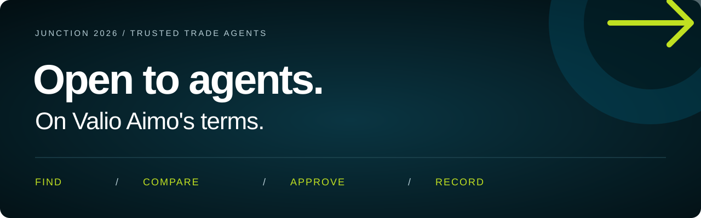

# Open to Agents

[](https://www.youtube.com/watch?v=BWGWDc29ZfQ)

A purchasing workspace and owner-controlled gateway for Valio Aimo's
**Trusted Trade Agents** challenge at Junction 2026. Built by **The Delusionals**.

`Request -> lookup -> compare -> approval when needed -> mock order`

- Find products and compare fixed prices, stock, delivery and supplied sustainability labels.
- Enforce spending limits, separate human approval, fresh quotes and duplicate-safe commitments.
- Explain purchasing decisions through a persistent, exportable audit trail.

[Watch demo](https://www.youtube.com/watch?v=BWGWDc29ZfQ) | [API & guardrails](docs/gateway-contract.md) | [Run & verify](docs/running.md) | [Slides (PDF)](docs/presentation/slides.pdf) | [Video source](video/)

## Try it locally

Python 3.12+ and [uv](https://docs.astral.sh/uv/). Fixture mode needs no API key or downloaded data.

```sh
uv sync --frozen --extra dev
uv run aimo-gateway init --mode fixture
uv run aimo-gateway policy --mode fixture --autonomous-limit 50000
uv run aimo-gateway serve --workspace --mode fixture
```

Open **http://127.0.0.1:8000**. Sign in with the `chef` token from
`data/gateway/fixture/credentials.json`; use a private window and the `manager`
token for approvals. The example sets a EUR 500 autonomous limit, in cents.
Generated credentials and runtime data stay out of Git.

## Scope

OpenAPI 3.1; deterministic request planning by default. The demo uses synthetic
data and records **local mock orders**, not supplier purchases or payments.
Live mode requires separate challenge access; optional xAI inference is not
runtime-verified. This is a local prototype, not a production deployment.

No project license is granted. Bundled third-party assets retain their own notices.
