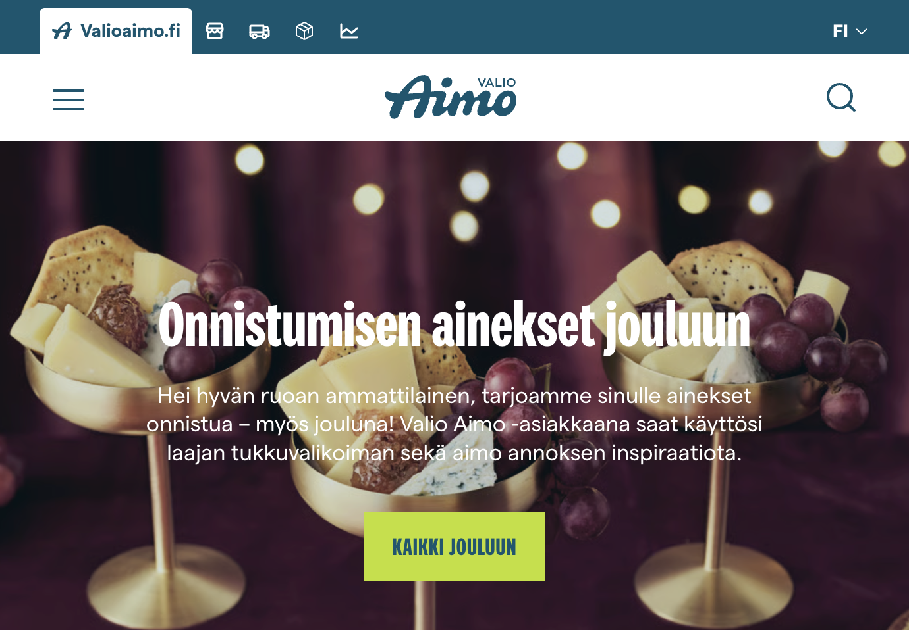
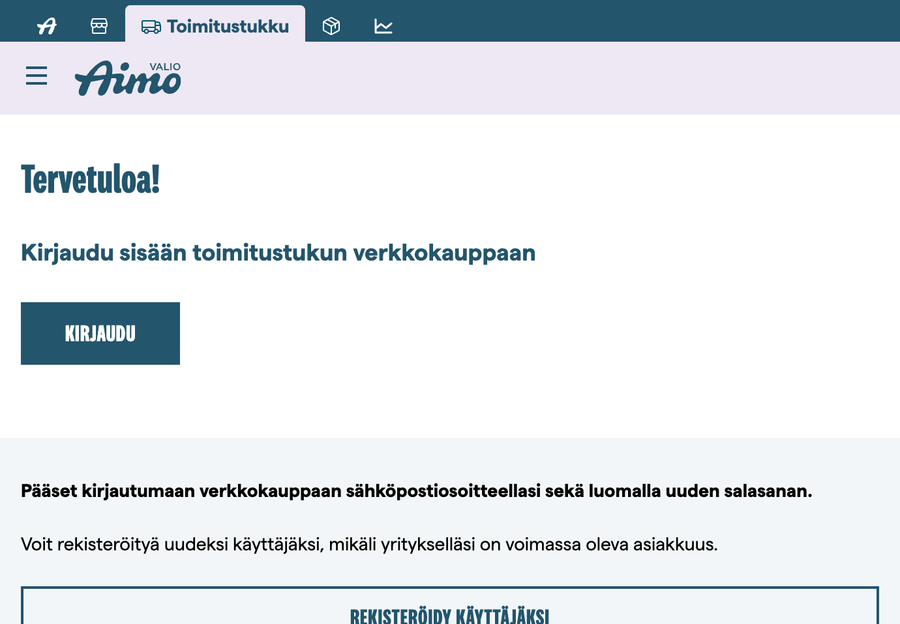
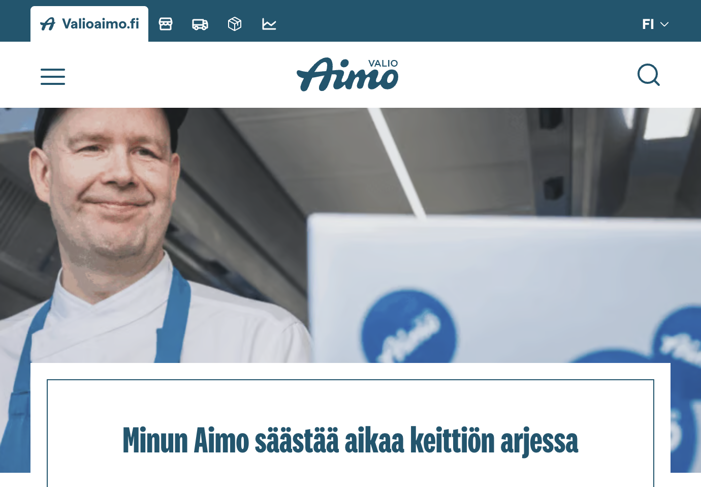
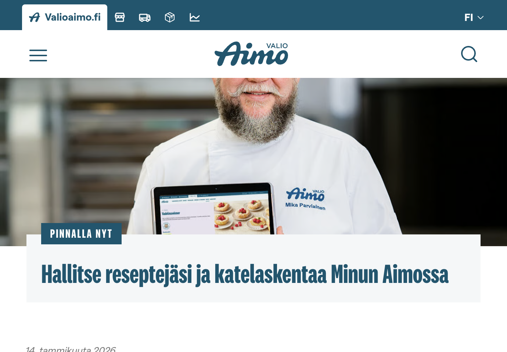
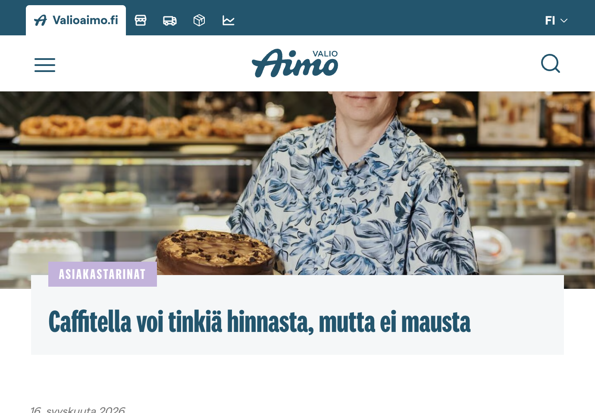

# Valio Aimo: Brand and Customer Research

Research date: 2026-11-14 (Europe/Helsinki). Sources are Valio Aimo's public
website and the challenge resource portal. Observations describe the pages
available on this date, not an official design system or brand license.

## Design Hypothesis

The prototype should feel like a new purchasing capability inside Valio Aimo's
existing digital services. Reuse its observed visual language in a compact
ordering workspace, not the promotional layout of the public homepage.

The working product direction remains broad foodservice purchasing with a
deliberately focused wedding-pie implementation. Brand research informs that
direction; it does not establish additional implemented capabilities.

## Company and Product Context

Valio Aimo's public account dates its origin to the combination of Valio and
Heinon Tukku in 2021. Its positioning combines wholesale breadth with product
expertise, customer-specific service, and delivery reliability [S2]. The public
site separates HoReCa, institutional food services, and food manufacturing [S1].
This is a professional purchasing context, not consumer grocery shopping.

The challenge brief supplies the figures of 20,000+ professional customers,
25,000 product names, and 700 suppliers. Treat these as challenge-provided
context, not independently reconciled current operating metrics. The downloaded
synthetic dataset contains 17,546 products; it is not the whole live assortment.
Avoid the conflicting revenue/export figures repeated in the brief.

The public service navigation distinguishes delivery wholesale, cash-and-carry,
VALO ordering, and Minun Aimo. Do not frame the prototype as a new marketplace or
an integration into all of these services. It is a proposed purchasing workspace
using the challenge's synthetic backend.

## Existing Capabilities: Important Differentiation

Minun Aimo already publicly advertises recipes, margin calculation, purchasing
and carbon reports, customer prices, customer service, and an AI helper named
A.I.mo [S3]. Its January 2026 recipe article describes recipe import with A.I.mo,
portion/serving changes, yield and waste, contract-price product suggestions,
and transferring ingredients to the webshop in the smallest sufficient sales
packs [S4]. These are published product claims, not features we tested behind
the production login.

The published webshop guide also describes multiple carts, order amendments,
sales units, availability, and both VAT-inclusive and VAT-exclusive prices [S5].
It is a 2024 guide, so do not treat it as a complete current interface inventory.

| Already described publicly | What our prototype should demonstrate |
| --- | --- |
| Recipes, portion scaling, pack rounding | Interpret an event-level request and produce a feasible purchasing plan |
| Customer prices and product selection | Check current mock prices and delivery feasibility under buyer constraints |
| A.I.mo assistance and recipe import | Execute a bounded purchasing workflow, not just answer questions |
| Recipe ingredients transferred to a cart | Handle exceptions, enforce delegated authority, and bind approval to a basket |
| Purchasing reports and order history | Explain the agent's selections and expose an auditable action record |

This is a proposed differentiation, not proof that Valio Aimo lacks these
capabilities internally. Confirm overlap with the mentor. Do not call our
prototype the first Valio Aimo AI assistant, or imply official A.I.mo integration.

## Verified Visual Evidence

Source: [Valio Aimo homepage](https://www.valioaimo.fi/), inspected in Playwright.

- Navigation and section headings use `rgb(0, 86, 112)`, equivalent to `#005670`.
- Sampled header body text uses `rgb(35, 40, 45)`, equivalent to `#23282D`.
- Headings declare `National, helvetica, arial, sans-serif`; body and navigation
  declare `Matter, helvetica, arial, sans-serif`. These are computed CSS font
  declarations, not confirmation of licensing or proof that every glyph uses
  the first declared font.
- Sampled headings are bold, with a 50px marketing H1 and 34-40px section headings.
  Those sizes are references for the public site, not proposed dashboard sizes.
- The site links to professional recipes, customer stories, a delivery webshop,
  and Minun Aimo, rather than presenting purchasing as a generic chat experience.

The browser font set reported National 700 and Matter 400/700 as loaded. The
public webshop login uses the related family name `National2Compressed` for
headings and action buttons, with Matter for body text [S6]. Do not assume the
marketing and webshop implementations use identical font files or weights.

| Observed token | Value | Evidence and application |
| --- | --- | --- |
| Brand teal | `#005670` | Public-site headings/navigation and webshop primary action |
| Lime action accent | `#C0E021` | Homepage primary links; teal text on lime |
| Dark body ink | `#23282D` | Sampled homepage header/body context |
| White | `#FFFFFF` | Public navigation surfaces and text on teal |
| Pale lavender | `#EEE8F5` | Public webshop header surface; optional small secondary accent |
| Button corners | `0px` | Sampled homepage calls to action and webshop login button |
| Heading typography | National / National2Compressed | Strong condensed display face, used sparingly in our workspace |
| Body typography | Matter | Readable regular/bold text for data and navigation |

The recognizable combination is teal, bright lime, white space, condensed
headings, square-edged actions, and real food/professional-kitchen photography.
The public homepage uses large image-led editorial bands; the webshop login is
quieter. Carry the identity into an operational layout rather than importing a
large marketing hero into the purchasing flow.

Do not treat every website behavior as a design requirement. Our forms still
need visible focus, readable wrapping, adequate contrast, and responsive layouts.
Use the lime as an action accent, not as the only signal for success or safety.

## Customer Evidence and Demo Implications

The following are public customer/partner stories or testimonials, not interviews
we conducted and not evidence that these organizations use our prototype.
The demo implications are our interpretation.

| Public example | Verified account | Implication for the prototype |
| --- | --- | --- |
| Wilderness Hotels / restaurant Aanaar, 2026-09-09 [S7] | The story describes eight hotels around Inari, seasonal menus, and the importance of dependable delivery days and exception communication. It explicitly describes purchasing from Valio Aimo. | Delivery feasibility and local preferences should constrain recommendations before price ranking. Useful hotel/event-catering context, but no wedding-pie use case is claimed by this source. |
| Caffitella, 2026-09-16 [S8] | The story describes 15 cafe-patisseries and an in-house bakery. Taste and ingredient quality matter, as do delivery reliability and receiving the products actually ordered. Celebration cakes and rapidly changing demand are part of its business. | Strongest bakery/event inspiration: do not silently substitute cheaper ingredients that change quality or recipe behavior. |
| Seinajoki city food services / Kasperitalo, 2026-06-17 [S9] | The article describes budget/nutrition constraints, domestic-product preferences, and an Aromi connection showing their contracted products. The featured kitchen serves 420 diners. | Customer entitlement and contract assortments matter. A generic full-catalog recommendation is not sufficient for a future institutional buyer. |
| Restbar Group and Strawberry hotels, testimonials on Minun Aimo [S3] | Restbar's testimonial stresses agreed products/prices and margin monitoring; Strawberry's describes resolving problems through self-service. | Explain price basis and make exceptions actionable without requiring another support channel. Do not generalize either testimonial into a claim about every group location. |

Recommended primary persona: **Demo Catering Kitchen**, a clearly fictional
professional kitchen handling a 100-guest wedding request. Draw its workload and
quality constraints from the bakery and hotel stories. Invented pantry stock,
budget, staff, dietary requirements, and approval policies must be labeled as
demo assumptions. Keep real company names in the research/pitch evidence, not
on fictional orders or testimonials.

## Brand and Asset Use

Match the observed design language, but make the environment visibly a
Junction prototype using synthetic data. Do not clone production sign-in,
collect real customer credentials, or imply a deployed Valio Aimo service.
Use the established Aimo name/logo only within organizer-approved brand use.

Obtain approved logo files and font rights before bundling proprietary assets.
A public asset URL is not a license grant. If fonts cannot be supplied, the
proposed fallback is a licensed condensed heading face such as Barlow Condensed
and a readable body face such as DM Sans, with their license files retained.
This is our fallback proposal, not Valio Aimo's official type specification.

Screenshots are limited research references. Do not extract customer portraits
or article photography from them for use as our own product imagery. For the
prototype, use permitted catalog images where available, or separately licensed
food images tied to the actual dish/product. Missing images must have an honest
placeholder, not an unrelated product photo.

## Screenshot Reference Gallery

Captured with Playwright on 2026-11-14 Helsinki time. These are public-page
viewport references, not our prototype, full-page captures, or authenticated
production screens. The integrated browser resets attempted viewport overrides
when capturing, so the final references use its native 690x479 CSS-pixel viewport
and 1380x958 image pixels. They are not desktop/mobile responsive-test evidence.
Only necessary cookies were accepted on the public content site.

### Homepage Identity

Source: [S1]. Teal service strip, centered Aimo identity, white navigation,
condensed display text, food imagery, and lime action accent. The seasonal hero
is a marketing reference, not the proposed workspace layout.

### Public Webshop Login

Source: [S6]. A quieter transactional surface with square teal actions and
simple typography. No production sign-in was attempted; this is not evidence
of the layout of an authenticated product list, basket, or checkout.

### Minun Aimo Overview

Source: [S3]. The existing digital service is marketed directly to working
kitchens. This captures its public introduction, not its signed-in dashboard.

### Existing Recipe Capability

Source: [S4]. The public article documents recipe management, margin calculation,
and recipe-to-basket ordering. The photograph includes a device displaying the
service; it is not a direct screenshot of the authenticated recipe editor.

### Customer Story: Caffitella

Source: [S8]. Public bakery/cafe customer-story presentation. The research uses
the article's operational themes, not the customer's identity for a fictional
purchase or an endorsement of this prototype.

## Sources and Limits

All sources accessed on 2026-11-14 Helsinki time. Customer-story dates are
publication dates. English descriptions above paraphrase the Finnish sources.

- [S1]: Public homepage, visual styles, service navigation.
- [S2]: Company origin, customer positioning, service channels.
- [S3]: Minun Aimo overview, A.I.mo, reports, recipes, and testimonials.
- [S4]: Recipe workflow, pack rounding, contract products; 2026-01-14.
- [S5]: Public webshop guide; published 2024-03-14.
- [S6]: Public production webshop login, visual inspection only.
- [S7]: Wilderness Hotels customer story; 2026-09-09.
- [S8]: Caffitella customer story; 2026-09-16.
- [S9]: Seinajoki customer story; 2026-06-17.
- [S10]: Challenge portal, catalog, and published OpenAPI contract.

We did not access authenticated production screens, a private brand guide,
real customer accounts, or actual purchasing policies. Challenge credentials
were not used on production sites. No production order was submitted. The
challenge API does not expose order commitment; that remains a local mock.

[S1]: https://www.valioaimo.fi/
[S2]: https://www.valioaimo.fi/valio-aimo-in-english/
[S3]: https://www.valioaimo.fi/asiakkaaksi/minunaimo/
[S4]: https://www.valioaimo.fi/artikkelit/pinnalla-nyt/reseptisi-ja-katelaskenta-minun-aimossa/
[S5]: https://www.valioaimo.fi/valio-aimo-in-english/new-online-store/
[S6]: https://toimitustukku.valioaimo.fi/fi/login
[S7]: https://www.valioaimo.fi/artikkelit/asiakastarinat/wilderness-hotels-tarjoaa-inarin-eramaan-kaikilla-aisteilla/
[S8]: https://www.valioaimo.fi/artikkelit/asiakastarinat/caffitella-voi-tinkia-hinnasta-mutta-ei-mausta/
[S9]: https://www.valioaimo.fi/artikkelit/asiakastarinat/seinajoella-kouluruokailua-kehitetaan-yhdessa/
[S10]: https://junction26.valioaimo.fi/